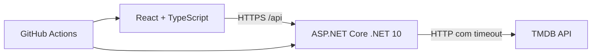

# CineSearch

Aplicação de portfólio para descobrir filmes e séries usando a API do TMDB. O projeto tem um frontend em React/TypeScript, uma API .NET 10 e validação com GitHub Actions.

> Dados e imagens fornecidos pelo [TMDB](https://www.themoviedb.org/). Este produto usa a API do TMDB, mas não é endossado ou certificado pelo TMDB.

## Demo ao vivo

- [Aplicação](https://cinesearch-jet.vercel.app)
- [API - health check](https://cinesearch-api-61a5.onrender.com/health)

## O que é possível fazer

- Buscar filmes, séries ou ambos, com paginação.
- Descobrir títulos por tipo, gênero, ano, nota mínima e ordenação.
- Consultar sinopse, elenco, criador/diretor, duração, temporadas, orçamento e bilheteria.
- Assistir ao trailer no YouTube quando o TMDB o disponibiliza e explorar recomendações.
- Receber feedback claro quando o catálogo estiver indisponível.

## Arquitetura



## Execução local

Use o SDK .NET 10, Node.js 24 e uma chave de API v3 do TMDB.

1. Copie `src/MovieAPI.API/appsettings.Development.json.example` para `src/MovieAPI.API/appsettings.Development.json` e preencha `TmdbSettings:ApiKey`.
2. Em um terminal, execute `dotnet run --project src/MovieAPI.API --launch-profile http`.
3. Em outro terminal, execute `cd frontend`, `npm ci` e `npm run dev`.

Abra `http://localhost:5173`. O Vite encaminha `/api` para `http://localhost:5171`.

### Docker

Copie `.env.example` para `.env` na raiz do projeto, preencha `TMDB_API_KEY` e suba os containers.

```bash
docker compose up --build
```

Abra `http://localhost:5173`. O Nginx encaminha `/api` para o container da API, que também responde em `http://localhost:5000`.

## Qualidade

```bash
dotnet test MovieAPI.sln
node --test scripts/smoke-production.test.mjs
cd frontend
npm ci
npm run lint
npm run test -- --run
npm run build
```

A CI audita dependências diretas e transitivas, executa testes, lint e build e verifica o funcionamento do Compose sem usar uma chave real do TMDB.

## Deploy gratuito

1. Crie a API pelo blueprint `render.yaml` no Render. Configure `TmdbSettings__ApiKey` com a chave do TMDB e `Cors__AllowedOrigins__0` com a origem HTTPS do frontend, sem barra final.
2. Na Vercel, use `frontend` como diretório raiz e configure `VITE_API_URL` no ambiente Production com a origem HTTPS da API, sem `/api`. Refaça o deploy da Vercel após alterar a variável.
3. Após a CI e os dois deploys do mesmo commit, execute **Verificar produção** no GitHub Actions, selecionando `main`. A verificação confirma o deploy da Vercel, o commit informado pelo Render, o catálogo, a busca, os detalhes e o link direto. O Render gratuito pode levar cerca de um minuto para responder após um período ocioso.
4. Abra a aplicação no navegador, aplique um filtro e confira os resultados. Abra um detalhe, recarregue a página e verifique o trailer e as recomendações quando estiverem disponíveis.

Nenhuma chave deve ser adicionada ao repositório.
